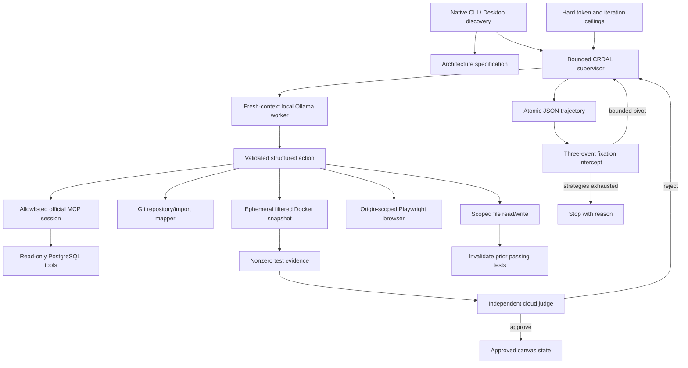

# Runtime architecture

## Layer contracts
1. `circuit_breaker.py` reserves conservative input/output tokens before every
   model call, and hard stops after a bounded number of iterations.
   `sandboxes/container.py` accepts only approved test argv prefixes, copies a
   filtered source snapshot, and starts a fresh disposable Docker container.
2. `tools/mcp_gateway.py` negotiates official MCP sessions. Only operator-selected
   servers and allowlisted tools are accessible. `tools/postgres_mcp.py` provides
   a bounded read-only database interface. `tools/repo_mapper.py` maps Git tracked
   files and Python import edges without scanning local credential files.
3. `worker_agent.py` issues one nonstreaming JSON-schema Ollama chat request per
   iteration. `tools/operator_tools.py` binds configured capabilities to actions.
   `tools/computer_use.py` handles browser state and selector/coordinate actions.
4. `telemetry.py` atomically persists bounded event metadata. `stall_detector.py`
   preserves the original three-repeated-errors-and-files predicate and excludes
   successful work. `judge_evaluator.py` validates strict independent verdicts.
5. `crdal_supervisor.py` owns state transitions, strategy changes, evidence
   invalidation, workspace locking, and final approval. `orchestration_canvas.py`
   exposes `doctor`, `init`, `verify-live`, `run`, and `status` commands.

## Trust boundaries
- The runtime checkout and operator-owned MCP configuration are trusted control
  inputs. The worker can only modify a separate target project.
- All model output, target files, pages, MCP results and test output are untrusted.
  Instructions in these sources do not grant additional tool permissions.
- Source edits happen through scoped host file operations; tests execute only in
  Docker. A Docker daemon with Linux-container support is a required dependency.
- Browser and stdio MCP processes execute on the host. Their configured origins,
  executables and database roles must be trusted. They are not Docker-isolated.
- Local Ollama sees task context and any requested screenshots. The configured
  cloud judge receives the task, changed code and test evidence at final review.
- Filename filtering is defense in depth, not a secret scanner. Keep sensitive
  files outside target projects and do not authorize sensitive database schemas.
- Docker is a kernel container boundary, not a micro-VM. The implementation does
  not claim protection against a compromised Docker daemon, hostile host user,
  browser zero-day, or a colluding worker and judge.

## Persistence and failure semantics
Each target has an independent `.aass/trajectory.json`, `.aass/canvas.json`, and
cross-platform file lock. Atomic replacement prevents partial JSON files after
normal write failures. Corrupt state is reported rather than silently reset.
A failed or interrupted task preserves source edits for inspection. Completion
requires tests after the most recent write plus explicit judge approval; failed
reviews and service errors never become success. External model connectivity or
HTTP failures stop the run with a service diagnosis. Other repeatable action/test
failures feed the fixation intercept and bounded alternative strategies.

Run budgets reset between invocations; source edits are not rolled back, committed
or pushed automatically. Telemetry stores metadata and failure hashes, not raw
prompts, model response bodies or credential values. Canvas reviews may contain
provider-written reasoning, so treat all `.aass` state as private local data.
